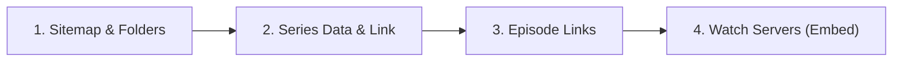

# AradramaTv Full Automation Pipeline (سكربت الأتمتة الشامل)

سكربت شامل ومتكامل يجمع ويشغل كافة مراحل استخراج وتجميع بيانات مسلسلات موقع **AradramaTv** بطريقة مؤتمتة وسريعة مع واجهة ترمنال متطورة، شريط تقدم مباشر، دعم استئناف العمل وتخطي ما تم تحميله، ونظام تسجيل مفصل (Logging).

---

## 🚀 نظرة عامة على مراحل الفلو (Pipeline Stages)

يغطي الفلو 4 مراحل رئيسية منظمة بتسلسل ذكي:



1. **Step 1: Sitemap & Folder Initialization**
   - استخراج جميع المسلسلات من الصفحات 1 إلى 82.
   - حفظ القائمة في `sitemap.json`.
   - إنشاء مجلد خاص بكل مسلسل داخل `aradramatv_links/` وتنظيف اسمه من أي رموز غير مسموحة (`\/*?:"<>|`).
   - وضع ملف `info.json` أولي يحتوي على اسم ورابط المسلسل.

2. **Step 2: Series Data Extraction**
   - سحب تفاصيل كل مسلسل من صفحته الرئيسية (الاسم العربي، الإنجليزي، الأسماء الأخرى، التصنيفات، البوستر، القصة، الأبطال، البلد، القناة، عدد الحلقات).
   - سحب رابط صفحة الحلقات (`episodes_url`).
   - تحديث ملف `info.json` الخاص بالمسلسل.

3. **Step 3: All Episodes Extraction**
   - الدخول على رابط الحلقات `episodes_url` وقراءة كافة صفحات الحلقات مع معالجة الترقيم المتعدد (Pagination مثل `/page/2/` أو `&paged=2`).
   - استخراج جميع الحلقات وترتيبها تصاعدياً من الحلقة 1 إلى الأخيرة.
   - حفظ قائمة الحلقات داخل ملف `info.json`.

4. **Step 4: All Watch & Embed Servers**
   - الدخول على رابط كل حلقة واستخراج جميع سيرفرات المشاهدة المتاحة (OK, Vidmoly, Filemoon, Dood, Streamtape, MixDrop, Vk, Wish, Lion...).
   - استخراج رابط المشغل الافتراضي (`player`).
   - **بدون أي فلترة أو استبعاد**، حفظ كافة السيرفرات مباشرة وبسرعة فائقة.

---

## 🖥️ مميزات الواجهة والترمنال (Terminal UI)

- **لوحة معلومات جذابة (Rich Console)**: تصميم متناسق ومريح للعين مع صناديق وجداول ملونة.
- **أشرطة تقدم حية (Live Progress Bars)**: توضح النسبة المئوية، العدد المنتهي/المتبقي، الوقت المتبقي المقدر، واسم المسلسل/الحلقة الجاري معالجتها حالياً.
- **دعم الاستئناف والتخطي (Smart Skip & Resume)**: أي مسلسل أو حلقة تم جلبها سابقاً يتم تخطيها تلقائياً بدون تكرار، ويمكن إيقاف السكربت وتشغيله في أي وقت بأمان.
- **سجل تشغيل مفصل (Logging)**: يتم تسجيل كافة الأحداث والعمليات والأخطاء تلقائياً في ملف `logs/pipeline.log`.
- **ملخص شامل (Summary Table)**: عند الانتهاء يعرض جدول إحصائي يوضح أعداد المسلسلات والحلقات والسيرفرات المكتملة.

---

## 🛠️ متطلبات التشغيل (Requirements)

الاعتماديات مثبتة بالفعل في البيئة الافتراضية للمشروع:
- `python >= 3.10`
- `curl_cffi` (لتجاوز الحماية ومحاكاة متصفح Chrome)
- `beautifulsoup4`
- `rich` (للواجهة الرسومية في الترمنال)
- `tqdm`

---

## 💻 طريقة الاستخدام (How to Run)

### 1. تشغيل الفلو كاملاً من البداية للنهاية:
```bash
python "/run/media/mostafa_emad/Data/e/Series Automation/aradramatv_cc/5____full_pipeline/pipeline.py"
```

### 2. تشغيل مرحلة محددة فقط (Single Step):
```bash
# تشغيل مرحلة السايت ماب والمجلدات فقط
python pipeline.py --step 1

# تشغيل مرحلة بيانات المسلسل فقط
python pipeline.py --step 2

# تشغيل مرحلة استخراج روابط الحلقات فقط
python pipeline.py --step 3

# تشغيل مرحلة استخراج سيرفرات المشاهدة فقط
python pipeline.py --step 4
```

### 3. خيارات إضافية (CLI Options):
- `--force`: إعادة تحميل السايت ماب من الموقع حتى لو كان `sitemap.json` موجوداً.
- `--workers <number>`: تحديد عدد المسارات المتزامنة (Threads) لتسريع التحميل (الافتراضي: 15).

مثال:
```bash
python pipeline.py --step 4 --workers 25
```

---

## 📁 هيكل مجلدات المشروع (Directory Structure)

```text
aradramatv_cc/
│
├── 1____sitemap/
│   └── 1_extract_sitemap.py
├── 2____extraxt_data_seriees_and_link_final/
│   └── extraxt_data_page_and_get_link.py
├── 3____extract_all_epciods_links/
│   └── extract_all_epcods_link.py
├── 4____get_embed_url/
│   └── extraxt_embed_url.py
├── 5____full_pipeline/
│   ├── pipeline.py        # السكربت الشامل للفلو كاملاً
│   └── README.md          # هذا الملف التوضيحي
├── aradramatv_links/      # مجلدات المسلسلات المنفصلة
│   ├── <Series_Name_1>/
│   │   └── info.json
│   └── <Series_Name_2>/
│       └── info.json
├── logs/
│   └── pipeline.log       # ملف اللوج الكامل
└── sitemap.json           # قائمة روابط وأسماء كافة المسلسلات
```

---

## 📋 هيكل ملف `info.json` النهائي لكل مسلسل

```json
{
  "title": "لعبة الاختطاف Kidnap Game",
  "url": "https://aradramatv.cc/2026/10/%d9%84%d8%b9%d8%a8%d8%a9-%d8%a7%d9%84%d8%a7%d8%ae%d8%aa%d8%b7%d8%a7%d9%81-kidnap-game/",
  "poster": "https://aradramatv.cc/wp-content/uploads/2026/10/...",
  "episodes_url": "https://aradramatv.cc/category/episodes/new/other/.../",
  "english_title": "Kidnap Game",
  "arabic_title": "لعبة الاختطاف",
  "other_names": "Kiddonappu Gemu",
  "genres": [
    "أكشن، إثارة، جريمة، درامي"
  ],
  "episodes_count": 11,
  "country": "اليابان",
  "network": "Channel A, Fuji TV",
  "broadcast_period": "06 أكتوبر 2026",
  "story": "تبدأ القصة باختطاف أشخاص في الوقت نفسه...",
  "cast": [
    {
      "actor": "Lee-Joon-Gi",
      "role": "Han Gi Ju"
    }
  ],
  "episodes": [
    {
      "episode": 1,
      "title": "لعبة الاختطاف الحلقة 01",
      "url": "https://aradramatv.cc/2026/10/...-01/",
      "player": "https://ok.ru/videoembed/17230647331485",
      "servers": {
        "OK": "https://ok.ru/videoembed/17230647331485",
        "Vidmoly": "https://vidmoly.org/embed-g7nrigli1peh.html",
        "Filemoon": "https://bysevepoin.com/e/jsaeyxy6a0tm",
        "Dood": "https://playmogo.com/e/y8qq2z587zxr",
        "Streamtape": "https://streamtape.com/e/Rg2evjGyQKcdgJ1/",
        "MixDrop": "https://mixdrop.top/e/9wn9wdj1a3lzzgq"
      }
    }
  ]
}
```

