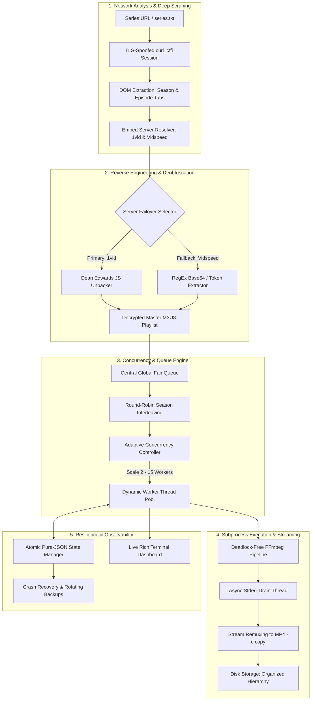

# 🎬 AhwakTV Smart Downloader & Stream Engine
### High-Performance HLS Stream Reverse Engineering, Distributed Dynamic Concurrency & Subprocess Architecture

[](https://www.python.org/)
[](https://json.org)
[](#high-performance-concurrency--threading-architecture)
[](#reverse-engineering--network-analysis)
[](#linux-subprocess--stream-engineering)
[](#test-suite--verification)

---

## 📌 Overview

**AhwakTV Smart Downloader is an enterprise-grade automated extraction, decryption, and media stream acquisition engine engineered to handle complex video-on-demand (VOD) catalogs across multi-season TV series.

Rather than relying on naive web scraping or fragile single-thread downloads, this system is architected as an **asynchronous, multi-worker parallel pipeline** designed to overcome modern streaming defenses: **TLS fingerprinting (JA3/JA4)**, **heavily obfuscated JavaScript players (Dean Edwards packer)**, **dynamic multi-server CDN failovers**, and **OS-level subprocess pipe deadlocks**.

The system strictly utilizes a **Zero-Database Architecture** (pure thread-safe atomic JSON state store) with zero external database dependencies, complete crash recovery, and intelligent round-robin season scheduling.

---

## 🏗️ Architecture & High-Level System Flow



---

## 🔬 Core Engineering & Technological Deep-Dive

### 1. Reverse Engineering & Network Analysis
Modern streaming platforms obfuscate network traffic and enforce bot detection mechanisms. This project implements advanced reverse engineering methodologies:

* **TLS & JA3/JA4 Fingerprint Impersonation:**
  Standard HTTP libraries (`requests`, `urllib3`, `aiohttp`) are trivially fingerprinted and blocked by WAFs (such as Cloudflare) at the TLS Client Hello handshake. This engine employs `curl_cffi` to mimic full **Chrome 131 HTTP/2 & TLS signatures**, including cipher suites, extension orders, and ALPN negotiation.
* **DOM Hierarchy Traversal:**
  Reverse-engineered the multi-tier SPA DOM structure of AhwakTV:
  `Series Root` $\rightarrow$ `.SeasonsEpisodesMains .tabcontent` $\rightarrow$ `Episode Grid` $\rightarrow$ `ul.WatchList li[data-embed-url]`.
* **Dean Edwards JavaScript Unpacking (`eval(p,a,c,k,e,d)`):**
  Embedded video hosts encrypt their player configurations inside self-extracting JavaScript closures. The engine features an in-memory **JavaScript Deobfuscator** that unpacks the packed string, decodes base-N dictionary token tables, and extracts the direct `.m3u8` master playlist URI using AST tokenization and regex matching.
* **Autonomous Multi-Server Failover:**
  The engine integrates dual video host resolvers:
  1. **Primary Server:** `1vid` (`1vid.xyz`) — Unpacks packer JS, verifies master playlist.
  2. **Secondary Fallback:** `Vidspeed` (`vidspeed.org` / `vidspeeds.org`) — Resolves fallback embeds if the primary server fails, times out, or returns HTTP 403/404.

```python
# Server Fallback Priority in action
for server_name in ["1vid", "vidspeed"]:
    embed_url = episode_servers.get(server_name)
    if embed_url:
        m3u8_url = extract_m3u8(embed_url, server=server_name)
        if m3u8_url and verify_stream(m3u8_url):
            return m3u8_url  # Zero downtime transition
```

---

### 2. High-Performance Concurrency & Threading Architecture

* **Central Global Fair Queue:**
  Rather than processing season by season sequentially (which causes worker starvation on season boundaries), all episodes across all seasons and series are loaded into a single unified queue.
* **Fair Season Round-Robin Interleaving:**
  To prevent Season 1 from hogging the entire worker pool, tasks are balanced across seasons using round-robin distribution:
  $$\text{Task Order: } [S_1E_1, S_2E_1, S_3E_1, S_1E_2, S_2E_2, S_3E_2, \dots]$$
* **Dynamic Adaptive Concurrency Controller:**
  A PID-style resource manager monitors hardware telemetry (`psutil` CPU% and RAM%) and network performance (packet drops, HTTP 429 rate limits, and latency spikes). It dynamically adjusts worker threads on the fly:
  * **Scale Up:** CPU $< 80\%$ and error rate $= 0\%$ $\rightarrow$ Scale worker threads up to `max_workers=15`.
  * **Scale Down / Backpressure:** CPU $> 85\%$ or HTTP 429 detected $\rightarrow$ Scale down gracefully to `min_workers=2` and enforce exponential backoff.
* **Thread-Safe In-Flight Deduplication:**
  Atomic locking guarantees that no two workers can claim or download the same episode simultaneously, preventing race conditions.

---

### 3. Linux Subprocess & Stream Engineering (Zero-Deadlock FFmpeg)

Downloading segmented HLS (`.ts`) video directly via Python HTTP calls incurs severe GIL contention and memory overhead. Instead, streams are delegated to high-performance native `ffmpeg` subprocesses.

#### ⚠️ The 64KB Linux Pipe Buffer Deadlock Bug (Solved)
In multi-worker environments, standard `subprocess.PIPE` buffers under Linux have an OS kernel limit of **64KB**. When FFmpeg prints continuous frame-by-frame progress and diagnostics, the `stderr` buffer fills up rapidly. Once full, the OS suspends FFmpeg from writing, causing a complete deadlock: Python waits for FFmpeg to finish, while FFmpeg waits for Python to read the pipe.

```text
[FFmpeg Process] ---> [Linux Kernel 64KB Pipe Buffer: FULL] ==BLOCKED==> [Python Main Thread Waiting]
```

#### ✅ The Solution: Non-Blocking Circular Daemon Drain
Each worker spawns a dedicated background daemon thread that drains `proc.stderr` continuously in real time into a bounded ring buffer (`collections.deque(maxlen=100)`):

```python
# Deadlock-free background pipe drainer
def _drain_stderr(proc, buffer):
    try:
        for line in iter(proc.stderr.readline, ''):
            if line:
                buffer.append(line.strip())
            else:
                break
    except Exception:
        pass
```
* Result: **Zero deadlocks**, instant responsive timeouts, and real-time error logging without memory leakage.
* Streaming uses `-c copy` (lossless remuxing), preserving original bitstream quality while consuming near-zero CPU.

---

### 4. Zero-Database Fault-Tolerant State Management (Pure JSON)

A strict design requirement was eliminating external databases (like SQLite) to keep the project completely portable and embeddable, while guaranteeing enterprise-level ACID-like durability.

* **Atomic File Replacement:** State files are never modified in-place. Updates are serialized to temporary files (`tempfile.NamedTemporaryFile`) on the same filesystem and atomically swapped via `os.replace()`, preventing state corruption even during sudden crashes or power failures.
* **Rotating Snapshots:** Automated rotating backups (`data/state_backup_*.json`) maintain a rolling history of the last 10 snapshots.
* **Self-Healing Crash Recovery:** On startup, the engine scans the state tree. Any episode marked as `"downloading"` from an interrupted run is safely reverted to `"pending"` with integrity checks on partial files.

---

### 5. Observability & Rich Terminal UI

The system features a live, interactive multi-panel terminal dashboard powered by `rich`:
* **Worker Fleet Status:** Displays active thread ID, series name, season/episode, target server (`1vid` / `vidspeed`), throughput speed, and elapsed time.
* **Global Progress Gauges:** Total episodes completed, failed, in-progress, and pending.
* **Telemetry Stats:** System CPU load, RAM usage, and current dynamic worker count.

---

## 📂 Project Structure

```text
AhwakTV_Smart_Downloader/
├── series_downloader.py     # Core Engine: Orchestration, Queue, Scraper, Downloader
├── config.json              # Central Configuration (Workers, Timeouts, Server Priority)
├── requirements.txt         # Minimal Python dependencies
├── series.txt               # Input target URLs (supports comments and multiple links)
├── test_suite.py            # Complete Unit & Integration Test Suite (11 comprehensive tests)
├── Downloaded_Series/       # Auto-created output directory for downloaded media
├── data/                    # JSON State Files & Atomic Rolling Backups
└── logs/                    # Rotating execution logs with timestamped diagnostics
```

---

## 🚀 Quickstart & Usage

### 1. Requirements & System Dependencies
* **Python:** 3.10 or higher
* **FFmpeg:** Installed on your system (`ffmpeg` and `ffprobe` in system PATH)

```bash
# Ubuntu / Debian
sudo apt update && sudo apt install -y ffmpeg

# Arch Linux
sudo pacman -S ffmpeg

# macOS (Homebrew)
brew install ffmpeg
```

### 2. Installation
```bash
# Clone or navigate to the project directory
cd AhwakTV_Smart_Downloader

# Create and activate a virtual environment
python3 -m venv .venv
source .venv/bin/activate

# Install Python dependencies
pip install -r requirements.txt
```

### 3. Configuration
Add target series URLs to `series.txt`:
```text
# Add one URL per line:
https://yam.ahwaktv.net/view-serie.php?name=موضوع-عائلي
```

Adjust engine parameters in `config.json` (optional):
```json
{
  "downloads": {
    "min_workers": 2,
    "initial_workers": 5,
    "max_workers": 15,
    "adaptive_enabled": true
  },
  "servers": {
    "priority": ["1vid", "vidspeed"]
  }
}
```

### 4. Running the Engine
```bash
python series_downloader.py
```

### 5. Running the Test Suite
Verify complete system integrity across all subsystems:
```bash
python test_suite.py
```

Expected Output:
```text
[PASS] Test 1: Successfully queued 32 episodes across 3 seasons in one Central Global Queue.
[PASS] Test 2: Fair Round-Robin verified; first 3 tasks pulled from seasons: [1, 2, 3].
[PASS] Test 3 & 4: All 32 episodes processed continuously across dynamic workers.
[PASS] Test 5: Verified zero idle worker stalls when eligible tasks exist in queue.
[PASS] Test 6: Intelligent retry with exponential backoff & delay verified.
[PASS] Test 7 & 8: Adaptive controller dynamically scaled workers (Down: 3, Up: 7).
[PASS] Test 9: Deduplication and in-flight locking verified; no duplicate processing.
[PASS] Test 10: Stale interrupted task restored to 'pending' state successfully.
[PASS] Test 11: 4 episodes succeeded despite episode 3 failure; queue not halted.
[PASS] Test 12: Stderr drained concurrently in background thread; zero pipe deadlock.
[PASS] Test 13: VidSpeed extraction and automatic fallback from 1vid to Vidspeed verified.

Ran 11 tests in 0.605s
OK
```

## 📜 License
This project is licensed under the MIT License - see the LICENSE file for details.

