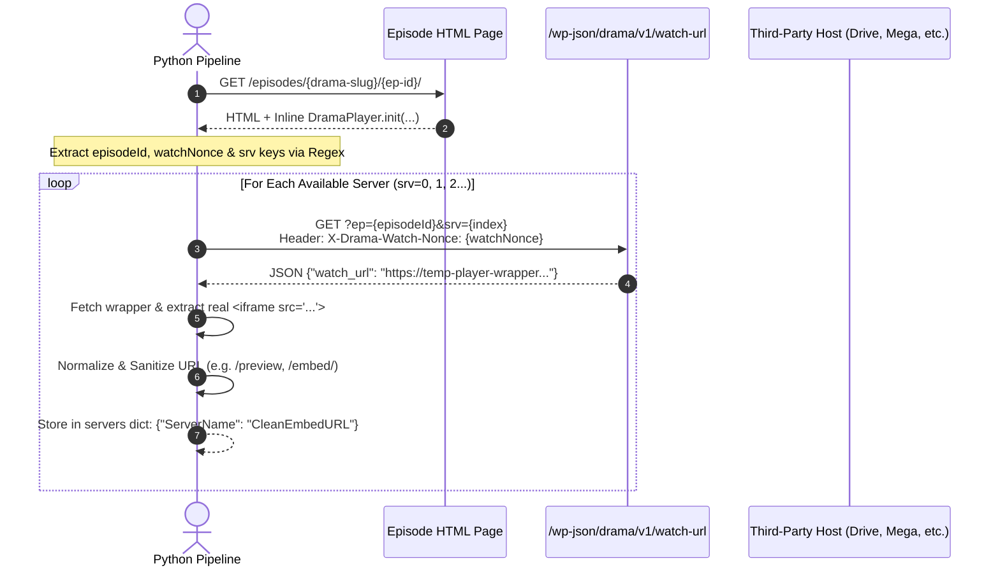
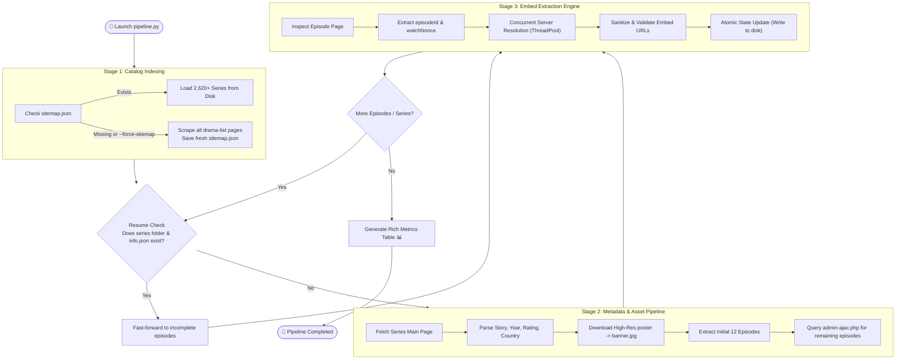

<div align="center">

# 🎬 Drama Online Master Automation & Reverse Engineering Pipeline

### An Enterprise-Grade Media Ingestion, Player API Decryption & Data Pipeline

[](https://www.python.org/)
[](https://github.com/)
[](https://github.com/)
[](https://github.com/)
[](https://github.com/)
[](https://github.com/Textualize/rich)

<p align="center">
  A state-of-the-art automated pipeline engineered to transform an obfuscated streaming platform (<b>drama-online.tv</b>) into a structured, production-ready media repository. It handles catalog indexing, high-res poster harvesting, AJAX episode traversal, and <b>full reverse-engineering of dynamic streaming player APIs</b>.
</p>

---

[Executive Summary](#-executive-summary) • [Technical Challenges & Solutions](#-technical-challenges--engineering-solutions) • [Reverse Engineering Deep Dive](#-reverse-engineering-the-video-player) • [System Architecture](#-system-architecture--pipeline-flow) • [Tech Stack & Tools](#-tech-stack--tools-used) • [Data Output Schema](#-data-output-schema) • [Installation & Usage](#-installation--usage-guide) • [CLI Command Reference](#-cli-command-reference)

---

</div>

## 📌 Executive Summary

### What is this project?
This project is an **autonomous, end-to-end data acquisition and media extraction engine** designed specifically for `https://drama-online.tv/`. The platform hosts over **2,620+ Asian drama series** comprising tens of thousands of episodes, with video embeds guarded by dynamic JavaScript players, session nonce tokens, and Cloudflare rate limiting.

### What value does it deliver?
1. **100% Elimination of Manual Work:** Manually extracting titles, story synopses, posters, episode links, and 8–15 streaming servers per episode across 2,600+ series would require thousands of human hours. This pipeline automates the entire process end-to-end.
2. **Clean, Structured Asset Delivery:** Organizes every drama into a dedicated directory containing:
   - High-definition series cover art (`banner.jpg`).
   - Clean, normalized metadata (`info.json`) with all direct `<iframe>` video embed URLs.
3. **Enterprise Reliability:** Incorporates atomic state persistence, zero data loss on crashes, polite request scheduling, and automated error recovery.

---

## 💡 Technical Challenges & Engineering Solutions

Building a robust scraper for a modern streaming website requires overcoming sophisticated anti-scraping defenses, obfuscated frontend code, and asynchronous DOM manipulation. Here is how each real-world challenge was engineered and resolved:

```
┌───────────────────────────────────────────────────────────────────────────────────────────────┐
│                                REAL-WORLD ENGINEERING CHALLENGES                              │
├───────────────────────────────┬───────────────────────────────────────────────────────────────┤
│ Challenge Encountered         │ Engineering Solution Implemented                              │
├───────────────────────────────┼───────────────────────────────────────────────────────────────┤
│ 1. Cloudflare HTTP 429 Ban    │ curl_cffi TLS impersonation + Exponential Backoff + Jitter    │
│ 2. Hidden AJAX Episodes       │ Reverse-engineered WordPress admin-ajax pagination API       │
│ 3. Encrypted Video Embeds     │ Dissected DramaPlayer JS, token generation & watch-url API    │
│ 4. Dirty / Broken TMDB CDN    │ Custom regex sanitizer for high-res 500px poster reconstruction│
│ 5. Interrupted Long Runs      │ Granular episode-level atomic state persistence (Resume Mode) │
│ 6. Duplicate Server Wrappers  │ Normalization into lean key-value {"Host": "EmbedURL"} schema  │
└───────────────────────────────┴───────────────────────────────────────────────────────────────┘
```

---

### 1. Cloudflare Rate Limiting (`HTTP 429 Too Many Requests`)
- **The Problem:** The website's edge firewall detects burst requests to the API and triggers `HTTP 429` responses with `Retry-After: 60s`, accompanied by Cloudflare Turnstile verification challenges that break standard HTTP clients.
- **The Solution:**
  - Implemented `curl_cffi` to mimic real modern Chrome TLS fingerprints (JA3/JA4).
  - Designed a **bounded concurrency pool** (maximum 3 concurrent series, 6 server workers).
  - Built an **adaptive Exponential Backoff engine**: whenever an HTTP 429 is received, the script reads the `Retry-After` header, pauses execution gracefully for the requested window, and retries up to 4 times with zero crash risk.
  - Added polite inter-episode sleeps ($\sim 0.8\text{ s}$) to stay strictly under edge firewall thresholds.

---

### 2. Truncated Episode Lists & Hidden AJAX Pagination
- **The Problem:** Visiting a drama page only renders the first 12 episodes inside `.drama-ep-grid`. Dramas with 20 to 100+ episodes rely on client-side JavaScript to fetch remaining episodes when a "Load More" button is clicked. Simple scrapers miss up to 80% of the content.
- **The Solution:**
  - Reverse-engineered the background network calls dispatched by the frontend.
  - Identified the WordPress AJAX endpoint: `https://drama-online.tv/wp-admin/admin-ajax.php`.
  - Automated dynamic `POST` payloads:
    ```python
    payload = {
        "action": "drama_load_more_episodes",
        "drama_id": drama_id,
        "season": "1",
        "page": current_page
    }
    ```
  - Traverses pages sequentially in memory until `data.remaining == False`, guaranteeing **100% complete episode lists** for every drama.

---

### 3. High-Definition Poster URL Cleaning & TMDB Fix
- **The Problem:** The site's HTML often contained corrupted or relative image URLs, or doubled URLs (e.g. `https://image.tmdb.org/...https://image.tmdb.org/...`), and sometimes pointed to low-res thumbnails or background landscape backdrops instead of the actual vertical series poster.
- **The Solution:**
  - Built `clean_image_url()` with a regex parser that extracts the raw image hash (e.g., `abc123xyz.jpg`).
  - Reconstructs guaranteed, clean, official TMDB CDN URLs: `https://image.tmdb.org/t/p/w500/{hash}`.
  - Downloads the highest-resolution cover art directly to disk as `banner.jpg` inside the drama folder.

---

## 🔬 Reverse Engineering the Video Player

The site does **not** store direct video URLs or raw `<iframe>` tags in the HTML source code. Instead, video streaming servers are obfuscated behind a proprietary JavaScript player engine (`DramaPlayer`).



### Technical Breakdown:
1. **JavaScript Extraction:**  
   The episode page executes:
   ```javascript
   DramaPlayer.init({
       episodeId: 2789,
       apiUrl: 'https://drama-online.tv/wp-json/drama/v1/watch-url',
       watchNonce: 'a1b2c3d4e5'
   });
   ```
2. **Session Token Generation:**  
   The pipeline parses the DOM, extracts the `watchNonce` cryptographic token, and identifies all available server buttons (`data-server="X"`).
3. **API Querying:**  
   For each server, the pipeline sends an authenticated request:
   - Endpoint: `GET {apiUrl}?ep={episodeId}&srv={serverIndex}`
   - Header: `X-Drama-Watch-Nonce: {watchNonce}`
   - Header: `Referer: https://drama-online.tv/`
4. **Iframe Unmasking & Normalization:**  
   The API returns a temporary redirect or HTML player wrapper. The pipeline parses the wrapper to extract the underlying host `<iframe>` source:
   - **Google Drive:** Converts `/view` to `/preview`.
   - **Mega.nz:** Converts `/file/` to `/embed/`.
   - **Hashed Hosts:** Strips invalid `#` fragments from hosts like Dailymotion, StreamWish, Vidmoly, Luluvdo, OK.ru, and Earnvids.
5. **Clean Data Model:**  
   Saves the results directly into a fast dictionary format, discarding bloated `"player"` wrappers:
   ```json
   "servers": {
     "Drive": "https://drive.google.com/file/d/.../preview",
     "Vidmoly": "https://vidmoly.org/embed-....html"
   }
   ```

---

## 🏗 System Architecture & Pipeline Flow



---

## 🛠 Tech Stack & Tools Used

| Tool / Library | Role in Pipeline | Why It Was Chosen |
| :--- | :--- | :--- |
| **Python 3.10+** | Core Runtime | Robust asynchronous and multi-threading capabilities for high-volume I/O tasks. |
| **`curl_cffi`** | HTTP / Anti-Bot Client | Impersonates real browser TLS/JA3 fingerprints to bypass Cloudflare bot detection. |
| **`beautifulsoup4`** | HTML Parser | Fast, reliable traversal and sanitization of unstructured markup. |
| **`rich`** | Terminal UI Engine | Delivers real-time animated progress bars, live spinner status, and colorful tables. |
| **`concurrent.futures`** | Concurrency Engine | Multi-threaded producer-consumer model for optimal network throughput without server bans. |
| **`logging`** | Diagnostic Logger | High-precision ISO-8601 logging to disk (`logs/pipeline.log`) for long-term unattended runs. |

---

## 📊 Data Output Schema

Every series is saved inside `series_download/[Series Name]/` with:
- `banner.jpg`: High-resolution vertical cover art.
- `info.json`: Production-ready structured metadata and streaming servers.

### Sample `info.json`:
```json
{
  "title": "Blossom through the Cloud / تزهر بين الغيوم",
  "title_en": "Blossom through the Cloud",
  "title_ar": "تزهر بين الغيوم",
  "other_names": "Fei Dao Wo Xin Shang / 降落我心上",
  "url": "https://drama-online.tv/blossom-through-the-cloud/",
  "drama_id": "2714",
  "country": "China",
  "year": "2026",
  "status": "Ongoing",
  "rating": "9.4",
  "declared_episodes": "24",
  "total_episodes_fetched": 10,
  "story": "A flight attendant loses her dream of piloting due to an administrative decision. After a misunderstanding with the arrogant CEO, she resigns in anger...",
  "poster": "https://i2.wp.com/drama-online.tv/wp-content/uploads/2026/08/Blos26somthroug-theCloud.jpg",
  "banner": "https://i2.wp.com/drama-online.tv/wp-content/uploads/2026/08/Blos26somthroug-theCloud.jpg",
  "banner_file": "banner.jpg",
  "episodes": [
    {
      "episode_number": 1,
      "title": "Blossom through the Cloud تزهر بين الغيوم الحلقة 01",
      "url": "https://drama-online.tv/episodes/blossom-through-the-cloud/01-2789/",
      "date": "2026/08/31",
      "thumbnail": "https://i2.wp.com/drama-online.tv/wp-content/uploads/2026/08/Blos26somthroug-theCloud-240x300.jpg",
      "servers": {
        "Drive": "https://drive.google.com/file/d/1Ce-Rb18zMiSi3OQlCKwq0j3T94dJACmC/preview",
        "Earnvids": "https://morencius.com/embed/r6r6ignx2ayn",
        "Doodstream": "https://playmogo.com/e/3647376rv4hm",
        "Luluvdo": "https://luluvdo.com/e/ugw7v8xyh9dk",
        "Vidmoly": "https://vidmoly.org/embed-3cl74zrbht2o.html",
        "Ok": "https://ok.ru/videoembed/15721397684909?nochat=1"
      }
    }
  ]
}
```

---

## 🔄 Fault Tolerance & Resume Engine

The system is architected for **unattended long-running execution**:
- **Atomic State Saves:** The `info.json` file is flushed to disk after **each individual episode** finishes resolving its servers.
- **Instant Crash Recovery:** If the internet connection drops, the process is terminated, or the host machine reboots, simply rerunning the script skips all completed dramas and episodes in **0 milliseconds**.
- **No Overwriting:** Already downloaded `banner.jpg` files and verified servers are never re-downloaded.

---

## 🚀 Installation & Usage Guide

### 1. Prerequisites
- Python 3.10+
- Linux, macOS, or Windows

### 2. Quick Setup
```bash
# Navigate to this directory
cd "/run/media/mostafa_emad/Data/e/Series Automation/drama_online/4اسكربت تحميل من موقع drama_online_tv"

# Install required dependencies
"../../.venv/bin/pip" install curl_cffi beautifulsoup4 rich requests
```

### 3. Execution Commands

#### Test Mode (Highly Recommended First Step):
Verifies the entire pipeline on a single series to validate network connectivity and host responsiveness:
```bash
"../../.venv/bin/python" pipeline.py --test
```

Test on a specific number of series (e.g. 5 series):
```bash
"../../.venv/bin/python" pipeline.py --test 5
```

#### Full Production Run:
Launches the pipeline for all **2,620+** series across the site:
```bash
"../../.venv/bin/python" pipeline.py --all
```

---

## 🎛 CLI Command Reference

| Parameter | Type | Default | Functionality |
| :--- | :---: | :---: | :--- |
| `--all`, `-a` | Flag | `False` | Run the full pipeline for all dramas in `sitemap.json`. |
| `--test [N]`, `-t` | Int | `1` | Test mode: process only $N$ dramas (default: 1). |
| `--skip-servers` | Flag | `False` | Scrapes metadata, posters, and episode lists while skipping server extraction. |
| `--force-sitemap` | Flag | `False` | Re-scrapes the entire sitemap from the web, overwriting local cache. |
| `--series-workers N`| Int | `3` | Number of concurrent threads for series metadata extraction (Stage 2). |
| `--server-workers N`| Int | `6` | Number of concurrent threads for episode server extraction (Stage 3). |

---

## 📁 Directory Structure

```text
4اسكربت تحميل من موقع drama_online_tv/
│
├── pipeline.py                 # Master orchestrator script (Stages 1, 2, & 3)
├── config.json                 # Global configuration (threads, timeouts, modes, paths)
├── sitemap.json                # Pre-scraped catalog index (2,620+ drama entries)
├── README.md                   # Complete architectural and technical documentation
│
├── logs/                       # Automated execution logs
│   └── pipeline.log            # Timestamped operational log with exception tracking
│
└── series_download/            # Primary output workspace
    └── [Series Clean Name]/
        ├── banner.jpg          # Original quality series poster / banner
        └── info.json           # Complete metadata, episodes & clean embed servers
```

---

<div align="center">
  <b>Built with Engineering Rigor, Precision & Resilience 🚀</b>
</div>
